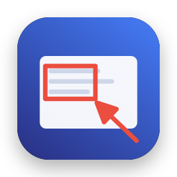
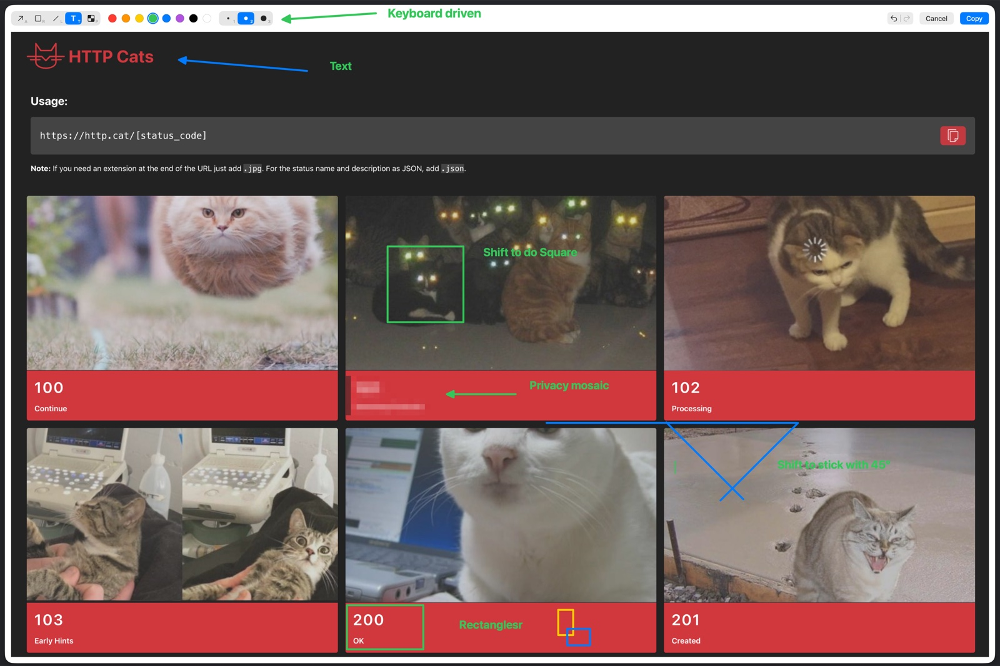

<p align="center">
  
</p>

<h1 align="center">Airink</h1>

<p align="center">
  A tiny, private, keyboard-focused macOS menu-bar app for annotating clipboard screenshots.
</p>

<p align="center">
  <a href="https://github.com/ojgenbar/airink/releases/latest"></a>
  
  <a href="LICENSE"></a>
</p>

**Hotkey → Annotate → Copy → Paste.** You can do the whole thing without the mouse, except for drawing itself. Every tool and width has a one-key shortcut, shown right on its button, and `Return` copies and closes.



1. Take a screenshot to the clipboard: `⌃⇧⌘4`.
2. Press `⇧⌘A`. Airink opens the image.
3. Draw arrows, rectangles, lines or text, or pixelate private details.
4. Press `Return` or `⌘C`. The annotated image goes to the clipboard and focus returns to your app.

`Esc` closes without touching the clipboard.

## Shortcuts in the editor

| Key | Action |
|---|---|
| `A` `R` `L` `T` `P` | Arrow, Rectangle, Line, Text, Pixelate |
| `1` `2` `3` | Thin, medium, thick (for Pixelate: block size) |
| `Shift` while dragging | Snap lines/arrows to 45°, make squares |
| `⌘Z` / `⇧⌘Z` or toolbar buttons | Undo / redo |
| `Return` / `⌘C` | Copy and close |
| `Esc` / `⌘W` | Close without copying |

With the Text tool, click to type. `⇧Return` (or `⌥Return`) starts a new line. `Return` or `Esc` finishes the text, and a second `Return` copies the image.

**Pixelate** covers an area with a coarse mosaic of the *original* image. It's always drawn beneath arrows, shapes and text, so you can annotate on top of it. Pixelated areas are always opaque. On images with transparency, they replace the transparent pixels too, so nothing underneath can show through.

The global shortcut can be changed in **Settings** (menu-bar icon › Settings…).

## Privacy

- No network access, telemetry, analytics or auto-updates.
- No Screen Recording, Accessibility or Input Monitoring permission.
- Runs in the App Sandbox with no extra entitlements.
- Reads the clipboard **only** when you press the shortcut. Nothing is stored on disk.

**First use:** macOS asks *"Airink would like to paste from …"*. That's the system's pasteboard privacy prompt (macOS 26). Choose **Always Allow** so it doesn't ask again. You can change it later in System Settings › Privacy & Security › Paste from Other Apps.

## Install

1. Download `Airink-<version>.dmg` from [Releases](https://github.com/ojgenbar/airink/releases), open it and drag **Airink** to **Applications**.
2. Open Airink from Applications. Airink isn't notarized by Apple yet, so macOS shows *"Apple could not verify 'Airink'…"*. Click **Done**, then go to System Settings › Privacy & Security, scroll down and click **Open Anyway**. This is needed only once per version.
   Or, in Terminal: `xattr -dr com.apple.quarantine /Applications/Airink.app`
3. Look for the pencil icon in the menu bar. To keep Airink running after a restart, turn on **Launch at Login** from that menu.

Settings (your shortcut and last-used tool, color and width) are kept across restarts and updates. Because releases are not yet signed with an Apple Developer ID, macOS may treat each new version as a new app. After updating, you may see the paste permission prompt again and need to re-enable Launch at Login.

## Requirements

- macOS 26 (Tahoe) or later
- Xcode 26 or later to build

## Build

To build the release DMG (Universal: Apple silicon + Intel), run `scripts/make-dmg.sh` → `build/Airink-<version>.dmg`.

To develop:

```sh
git clone <repo-url> airink && cd airink
open Airink.xcodeproj     # then ⌘R
```

Or from the command line:

```sh
xcodebuild -scheme Airink -configuration Release -derivedDataPath build build
open build/Build/Products/Release/Airink.app
xcodebuild -scheme Airink -destination 'platform=macOS' test
```

The project signs locally ("Sign to Run Locally"); no Apple Developer account is needed. For Launch at Login, copy `Airink.app` to `/Applications` first.

## Known limitations

- If the global shortcut is already taken by a system shortcut or by an app that doesn't register it exclusively, macOS may not report the conflict. If the shortcut does nothing, choose a different one in Settings.
- While Airink runs, `⇧⌘A` overrides other apps' use of that shortcut (e.g. Finder › Go › Applications).
- Text annotations can't be edited after they're committed (undo and re-type).

## Project layout

```
Airink/
  App/        App entry, menu-bar menu, AppModel (hotkey → editor flow, settings state)
  HotKey/     Carbon global hotkey wrapper, Shortcut model + persistence
  Clipboard/  Pasteboard read/write (PNG/TIFF/JPEG/HEIC in, PNG out)
  Model/      Annotation types, AnnotationDocument (+ undo)
  Render/     Core Graphics renderer shared by canvas and export
  Editor/     Editor window, canvas, SwiftUI toolbar, key commands
  Settings/   Settings view with shortcut recorder
AirinkTests/  Swift Testing unit tests
docs/DECISIONS.md  Platform investigation and architectural decisions
scripts/      make-dmg.sh (release DMG), make-icon.swift (builds the icon set from design/icon-source.png)
```

## License

[MIT](LICENSE)
